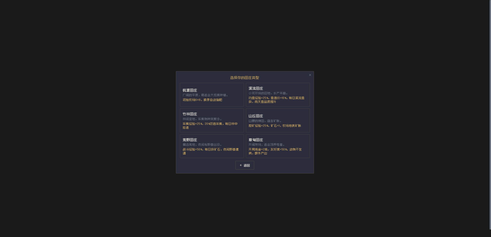
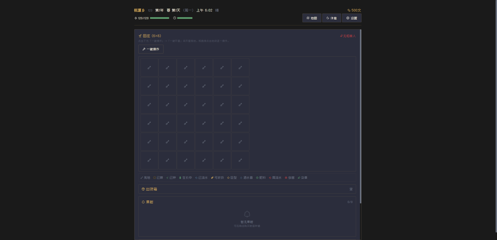

# Taoyuan Township

Taoyuan Township is a text-based farming and life-simulation game inspired by Stardew Valley. Build a farm, grow seasonal crops, raise animals, fish, explore mines, craft items, cook, and get to know the villagers.

This project is based on [setube/taoyuan](https://github.com/setube/taoyuan). The original project and its assets are licensed under [CC BY-NC 4.0](https://creativecommons.org/licenses/by-nc/4.0/); see [LICENSE](./LICENSE) for details. Commercial use is not permitted without the author's written authorization.

## Features

- Four seasons, changing weather, and a day-and-night cycle
- Crop farming, fruit trees, sprinklers, fertilizers, and a greenhouse
- Livestock, fish ponds, breeding, and item processing
- Fishing, mining, combat, guild requests, and museum collections
- Villager relationships, festivals, quests, achievements, and hidden characters
- Cooking, equipment, inventory, storage, and save import/export
- Procedurally generated music and sound effects
- Web, desktop (Electron), and Android builds

## Screenshots





## Getting started

### Requirements

- [Bun](https://bun.sh/)
- [Git](https://git-scm.com/) (for cloning the repository)

### Run locally

```sh
git clone https://github.com/Kidusfikru/taoyuan.git
cd taoyuan
bun install
bun run dev
```

### Checks and production build

```sh
bun run type-check
bun run lint
bun run build
```

To preview the production build locally:

```sh
bun run preview
```

### Docker

```sh
docker build -t taoyuan .
docker run --rm -p 8080:80 taoyuan
```

Open [http://localhost:8080](http://localhost:8080).

### Desktop and Android

```sh
bun run build:electron
bun run build:android
```

Android release signing is optional for local builds. To sign a release APK, provide these environment variables: `ANDROID_KEYSTORE_PATH`, `ANDROID_KEYSTORE_PASSWORD`, `ANDROID_KEY_ALIAS`, and `ANDROID_KEY_PASSWORD`. Never commit a keystore or signing credentials.

## Technology

- Vue 3 and TypeScript
- Vite and Tailwind CSS
- Pinia and Vue Router
- Tone.js
- Capacitor and Electron

## Project layout

```text
src/
  components/   Reusable game components
  composables/  Shared game logic
  data/         Game content and definitions
  stores/       Pinia state stores
  types/        TypeScript types
  views/        Menus and game screens
  router/       Application routes
  assets/       Fonts and images
android/        Capacitor Android project
electron/       Electron desktop entry points
images/         Screenshots and project imagery
```

## Links

- [Original project](https://github.com/setube/taoyuan)
- [TapTap page](https://www.taptap.cn/app/816558)

## License

This project is distributed under [Creative Commons Attribution-NonCommercial 4.0 International](https://creativecommons.org/licenses/by-nc/4.0/). You may share and adapt it with attribution, but may not use it commercially without written authorization. See [LICENSE](./LICENSE).
